<p align="center">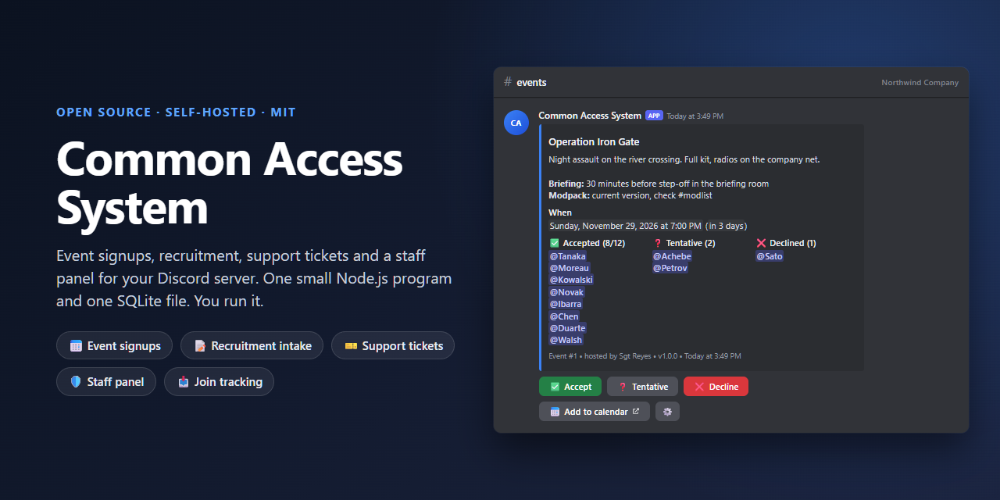</p>

# Common Access System

A self-hosted Discord bot for gaming communities, clans and milsim units. One bot
covers the day-to-day running of a server:

- **Event signups** with a live roster, reminders and start-time pings
- **Recruitment intake**: an application form and a private channel per applicant
- **Support tickets**: private channels between a member and your staff
- **A staff control panel** for roles, nicknames, timeouts and kicks
- **Join and leave notices** that say which invite link someone used

Everything is set up from inside Discord with `/setup`. No website or database
server is needed: the bot is one small Node.js program with one SQLite file.

## A quick look

<table>
<tr>
<td width="50%">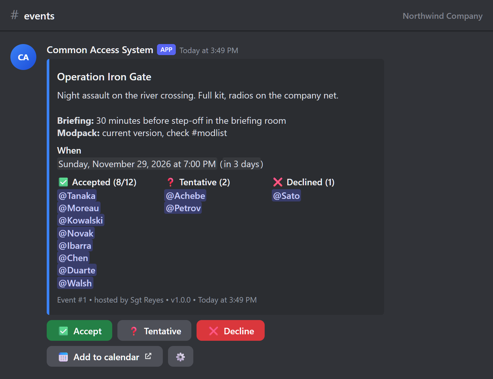<br><b>Event signups</b>: members RSVP with one click and the roster updates live.</td>
<td width="50%">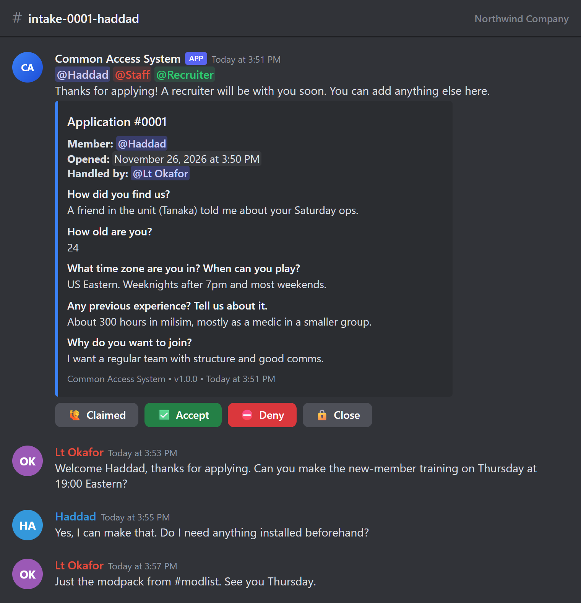<br><b>Recruitment</b>: every applicant gets a private channel with your recruiters.</td>
</tr>
<tr>
<td>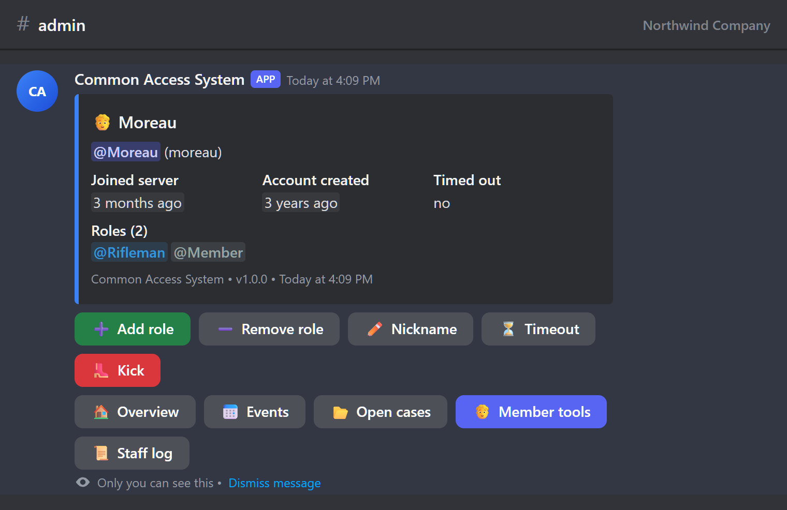<br><b>Staff panel</b>: roles, nicknames, timeouts and kicks, with role-order checks.</td>
<td>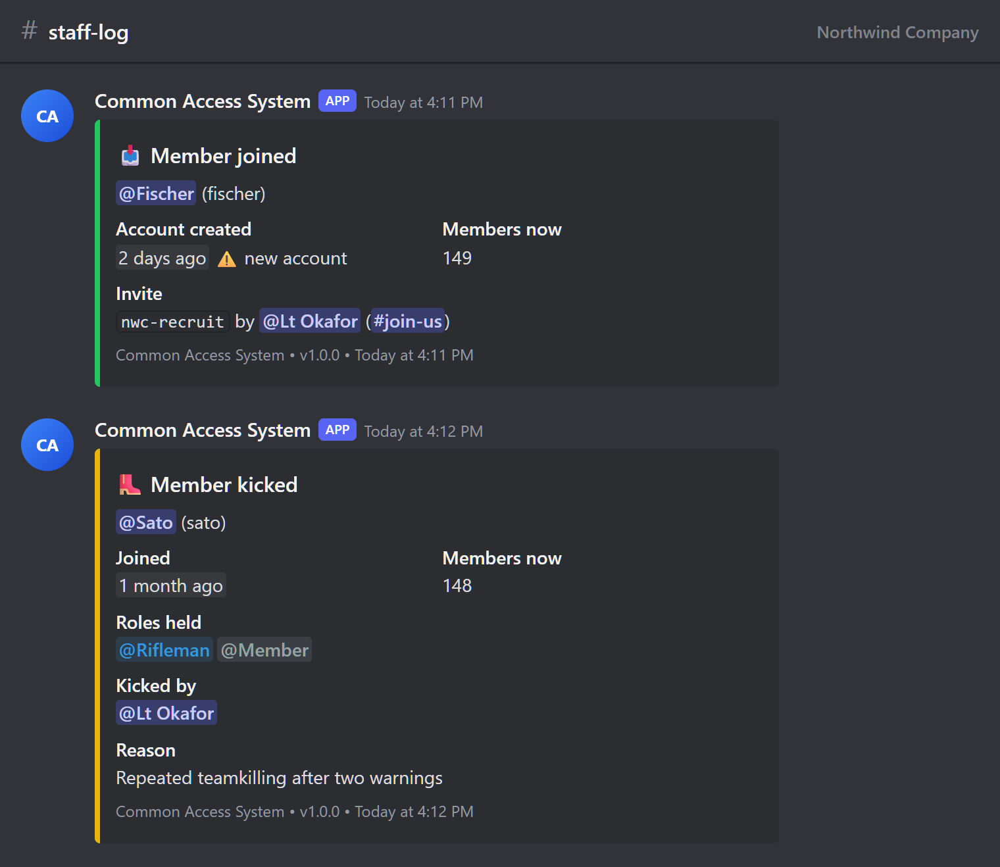<br><b>Join tracking</b>: which invite someone used, new-account flags, kicks and bans.</td>
</tr>
</table>

> **About these pictures.** They are drawn from the bot's real output. `npm run screenshots`
> runs every feature through the actual code, records what the bot posts, and draws it in
> a Discord-style dark theme. The server, people and chat lines are made-up example data.
> Your copy shows your own bot name, colour and icon (`BOT_NAME`, `ACCENT_COLOR` and
> `BRAND_ICON_URL` below).

## You host it yourself

There is **no hosted version** of this bot to invite. Each community runs its own
copy, with its own Discord application, on its own machine. You need:

| What | Notes |
|---|---|
| A machine that stays on | A small VPS, a home server, or a Raspberry Pi 4 or newer. The bot only works while it runs. |
| Node.js 22.13+ **or** Docker | Docker is the easiest way to keep it running and restart it after reboots. |
| Your own Discord application | Free, made in the Discord Developer Portal (steps below). Its token is yours alone. |
| About 100 MB of RAM and a few MB of disk | The database grows slowly (events, cases, the staff log). |

You are responsible for the server it runs on, keeping the token secret, backups,
and updates. Nothing is sent anywhere except to Discord.

## 1. Create the Discord application

1. Open the [Discord Developer Portal](https://discord.com/developers/applications) and click **New Application**. Give it your bot's name.
2. Open the **Bot** tab:
   - Click **Reset Token** and copy the token. This is `DISCORD_BOT_TOKEN`. Treat it like a password.
   - Under **Privileged Gateway Intents**, turn on **Server Members Intent** and **Message Content Intent**.
     The first is for join/leave notices and member tools, the second for ticket and application transcripts.
     Without them Discord refuses the login.
3. You will invite the bot in step 3; the bot prints the exact invite link when it starts.

## 2. Install and configure

```bash
git clone <the URL from this page's green Code button>
cd common-access-system
cp .env.example .env
```

Edit `.env`:

| Setting | What to put |
|---|---|
| `DISCORD_BOT_TOKEN` | The token from step 1. |
| `DISCORD_GUILD_ID` | Your server's ID: turn on Developer Mode (User Settings → Advanced), right-click your server icon → **Copy Server ID**. |
| `TIMEZONE` | The time zone your staff type event times in, e.g. `America/New_York`, `Europe/London`. Members always see times in their own zone. |
| `BOT_NAME`, `ACCENT_COLOR`, `BRAND_ICON_URL` | Optional branding for the bot's cards. |
| `REMINDER_MINUTES` | How long before an event members get a reminder (default 30). |

There is a filled-in example under [Examples](#examples).

### Run with Docker (recommended)

```bash
docker compose up -d --build
docker compose logs -f
```

The database lives in the `cas-data` Docker volume. The container restarts by itself.

### Or run with Node.js

```bash
npm ci --omit=dev
npm start
```

Use a process manager (systemd, pm2, or similar) to keep it running after you log out
and after reboots.

## 3. Invite the bot

On first start the bot prints a line like:

```
[ready] I am not in server 123... yet. Invite me with:
  https://discord.com/oauth2/authorize?client_id=...&permissions=...&scope=bot+applications.commands
```

Open that link, pick your server and authorize. The link asks for exactly the
permissions below. When the bot joins, it registers its slash commands in your server.

Then, in **Server Settings → Roles**, drag the bot's role **above** every role it
should be able to give, remove or manage. Discord does not let a bot touch roles
above its own.

| Permission | Used for |
|---|---|
| View Channels, Send Messages, Embed Links, Attach Files, Read Message History | Posting cards, transcripts and logs |
| Manage Channels | Creating private application and ticket channels |
| Manage Roles | Giving roles on accept, and the role tools in `/cas` |
| Manage Nicknames, Kick Members, Moderate Members | Nickname, kick and timeout tools in `/cas` |
| Manage Server | Reading invite links (join attribution and `/inviteledger`) |
| View Audit Log | Saying who kicked or banned someone |
| Mention Everyone | Pinging roles, `@here` or `@everyone` when an event starts |

## 4. Set it up in Discord

Run `/setup` (you need **Administrator** or **Manage Server**). Only you see the panel,
and every pick saves straight away. The card at the top always shows the current setup:

<p align="center">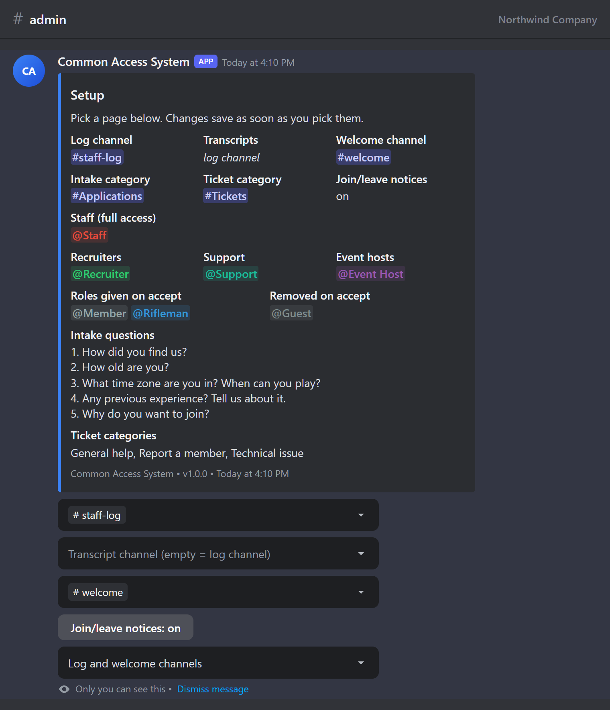</p>

It has five pages:

1. **Log and welcome channels**: a private staff log channel (joins, leaves, staff
   actions, transcripts), an optional separate transcript channel, and an optional
   public welcome channel for accepted recruits. Join/leave notices can be turned off.
2. **Categories for private channels**: the Discord categories where application
   and ticket channels are created. Keep these categories hidden from `@everyone`.
3. **Staff roles**:
   - *Staff*: full access to `/cas`, `/inviteledger` and every case and event.
   - *Recruiters*: handle applications.
   - *Support*: handle tickets.
   - *Event hosts*: may post `/signup`. Staff can always post.
4. **Recruitment intake**: the roles a recruiter may give on accept, an optional role
   to take away on accept (for example "Guest"), up to five application questions
   (45 characters each, Discord's limit for a form label), the welcome message, and a
   button to post the **application panel** in the current channel.
5. **Support tickets**: ticket categories and a button to post the **ticket panel**
   in the current channel.

Server admins (Administrator or Manage Server) count as staff everywhere. See
[Examples](#examples) for a channel and role layout, questions, categories and a
welcome message you can copy.

## Commands

| Command | Who | What it does |
|---|---|---|
| `/setup` | Server admins | Configure everything above. |
| `/cas` | Staff | Control panel: server overview, upcoming events, open cases, staff log, member tools. |
| `/signup` | Event hosts, staff | Post an event signup in the current channel. |
| `/inviteledger` | Staff | Post every used invite link, its use count and who joined through it, to the log channel. |

## How the features work

### Event signups

`/signup` opens a form: title, description, date and time (in `TIMEZONE`), an
optional image link and an optional limit on places. Next you pick which roles to
ping when the event starts (and optionally `@here` or `@everyone`), and whether
"Tentative" is offered. **Post signup** puts the card in the channel.

<table>
<tr>
<td width="42%">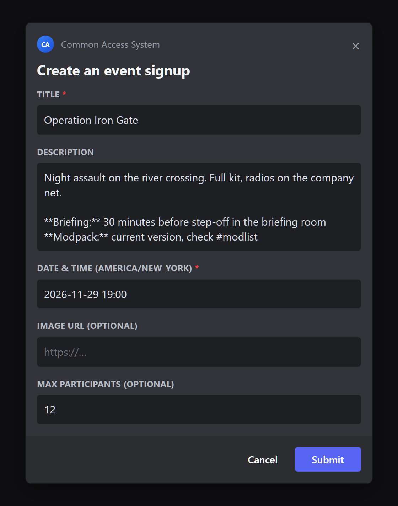</td>
<td width="58%">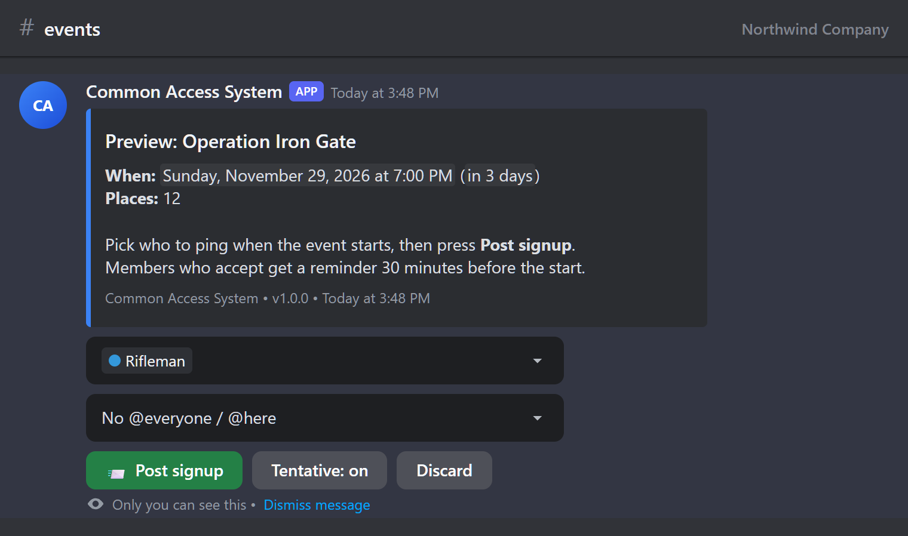</td>
</tr>
<tr><td>1. Fill in the form.</td><td>2. Check the preview, pick who to ping, post.</td></tr>
</table>

- Members press **Accept**, **Tentative** or **Decline**. Pressing the same button
  again takes their name off. When the places are full, Accept is refused.
- The card shows the time in each reader's own time zone and a live roster.
- **Add to calendar** opens a Google Calendar entry.
- `REMINDER_MINUTES` before the start, the bot replies to the card mentioning
  everyone who accepted or is tentative. At the start it pings the chosen roles.
  It never sends either more than two hours late (for example after downtime).
- The ⚙️ button lets hosts and staff edit the event (a new time re-arms the
  reminder) or cancel it. RSVPs close 12 hours after the start.

<p align="center">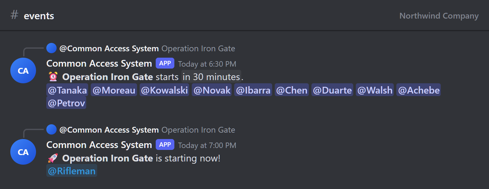</p>

### Recruitment intake

Post the application panel with `/setup` → Recruitment intake. An applicant presses
**Start application**, answers your questions, and gets a private channel that only
they, your recruiters, your staff and the bot can see. One open application per person.

<table>
<tr>
<td width="55%">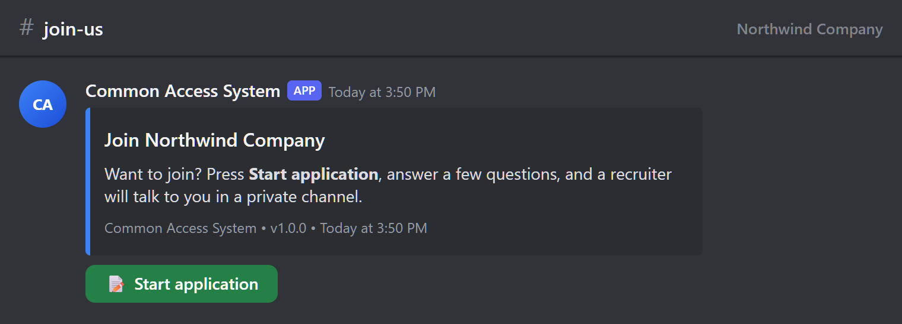<br><br></td>
<td width="45%">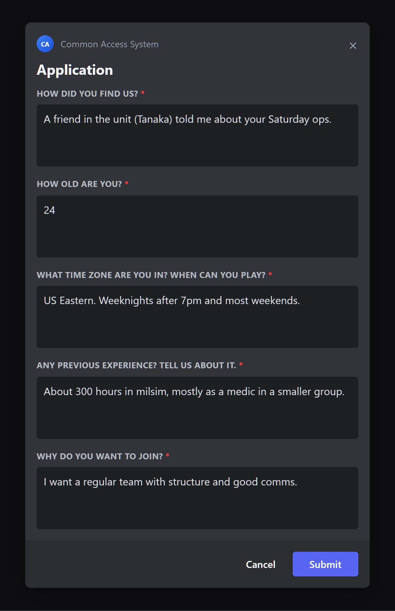</td>
</tr>
</table>

In the channel, recruiters can:

- **Claim** it, so others know who is handling it.
- **Accept**: pick roles from the allowed list (roles above the bot are never offered),
  then confirm. The bot gives the roles, removes the "on accept" role, posts the
  welcome message, DMs the applicant, and closes the channel.
- **Deny**: optionally type a reason, which is sent to the applicant by DM.
- **Close** without a decision.

<table>
<tr>
<td width="50%">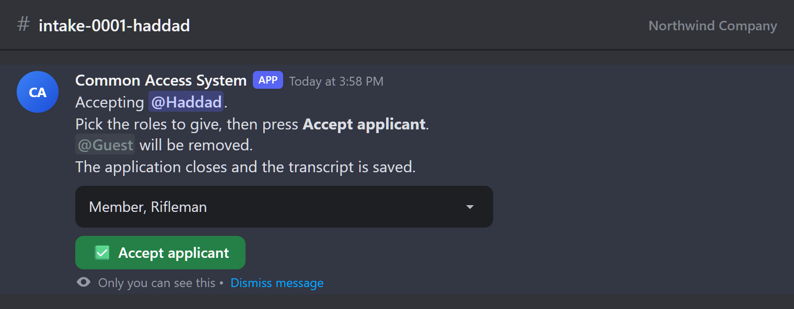</td>
<td width="50%">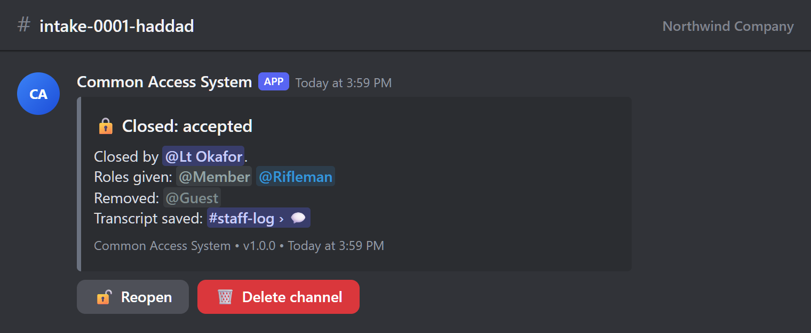</td>
</tr>
<tr><td>Accept: pick the roles, confirm.</td><td>The channel locks and the transcript is saved.</td></tr>
</table>

The new member is welcomed in your welcome channel (and by DM):

<p align="center">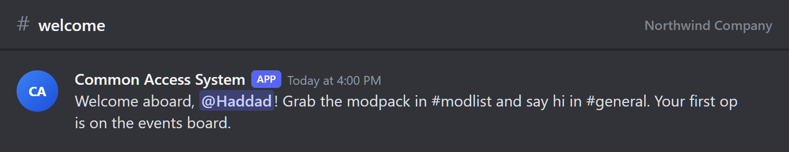</p>

### Support tickets

Post the ticket panel with `/setup` → Support tickets. A member picks a category,
fills in a subject and details, and gets a private channel with your support team.
The member or support staff can close it. Staff can reopen or delete it. Recruiters
do not see tickets unless they also have a support or staff role.

<table>
<tr>
<td width="45%">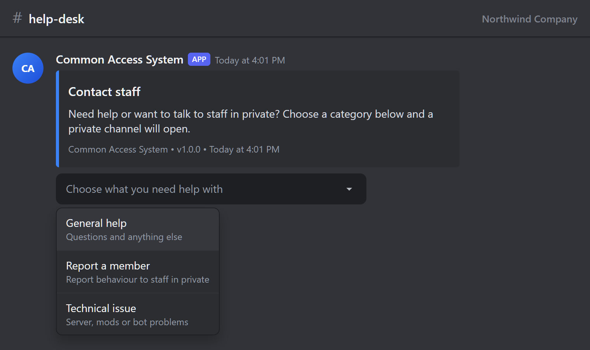</td>
<td width="55%">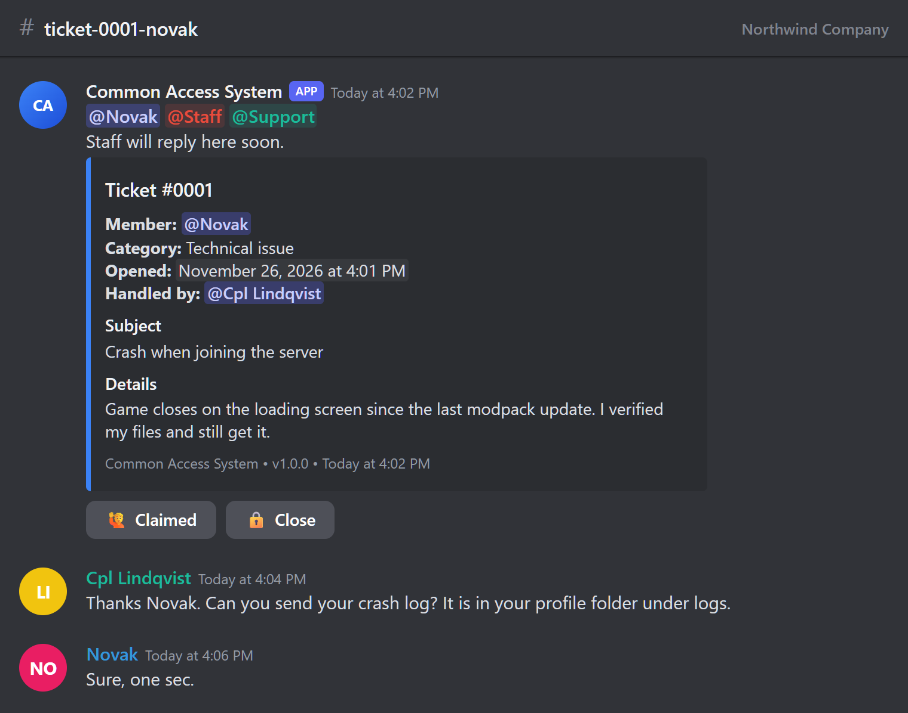</td>
</tr>
</table>

### Closing, transcripts and deleting

Closing an application or ticket stops the member from writing (they can still read),
saves a text transcript of the whole channel to the transcript channel (or the log
channel), and shows **Reopen** and **Delete channel**. Deleting asks for
confirmation and cannot be undone.

<p align="center">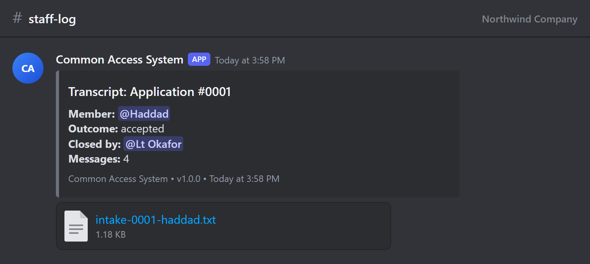</p>

[docs/examples/sample-transcript.txt](docs/examples/sample-transcript.txt) is the file
from the application above. Mentions stay in Discord's raw form (`<@id>`, `<t:time>`),
so you can always look up who was involved, even after people change their names.

### Staff control panel

`/cas` shows member count, open applications and tickets, upcoming events and bot
health, plus:

<table>
<tr>
<td width="50%">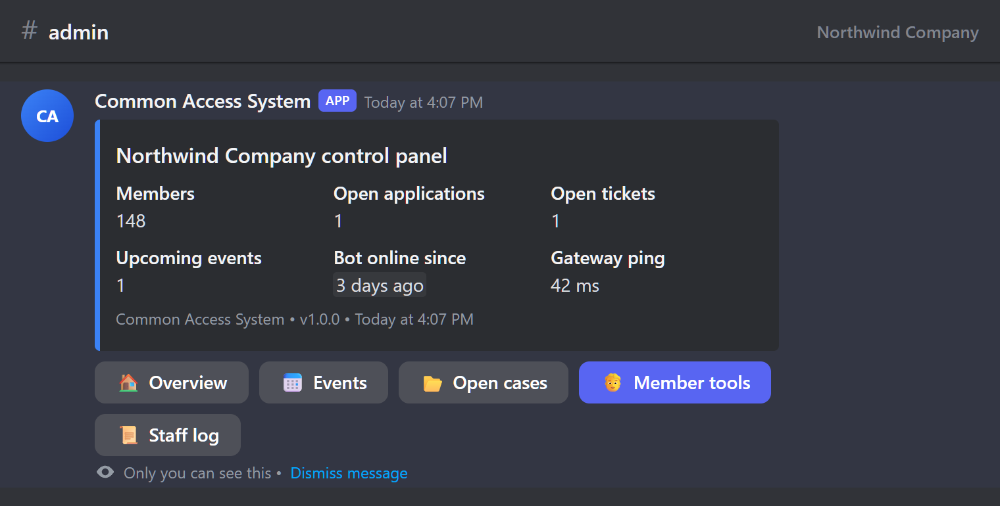</td>
<td width="50%">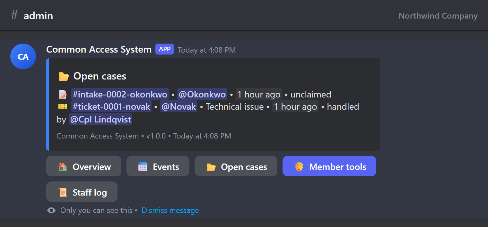</td>
</tr>
</table>

- **Member tools**: pick a member to see their roles, join date and account age,
  then add or remove a role, change their nickname, time them out, or kick them
  (a reason is required).
- **Staff log**: the latest staff actions.

The panel follows Discord's role order: staff cannot act on members at or above
their own highest role, cannot give roles at or above it, and nobody can act on
the server owner. Every action is posted to the log channel.

### Join and leave notices

When someone joins, the log channel gets a card with their account age (new
accounts are flagged) and the invite they used. Discord does not report which
invite was used, so the bot compares invite use counts: if exactly one went up,
that invite is named; otherwise the card says "ambiguous" or "unknown" rather than
guessing. Leaves, kicks (with who did it and why) and bans are logged too.

`/inviteledger` lists every invite that has been used, how often, who made it and who
joined through it:

<p align="center">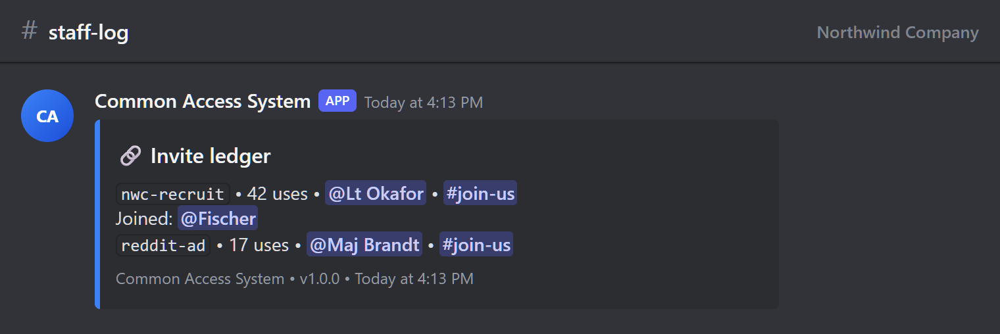</p>

## Examples

Starting points to copy and change.

### `.env` for a unit that plays on US Eastern time

```ini
DISCORD_BOT_TOKEN=paste-your-token-here
DISCORD_GUILD_ID=123456789012345678
TIMEZONE=America/New_York
BOT_NAME=Northwind Company
ACCENT_COLOR=#3b82f6
BRAND_ICON_URL=https://example.com/your-unit-logo.png
REMINDER_MINUTES=60
```

`BRAND_ICON_URL` must be a public `https://` link to an image (PNG or JPG). It appears
next to the bot's name at the bottom of every card. Leave it empty for none.

### Channels and roles to create first

A layout that works for most groups. Create these in Discord, then pick them in `/setup`.

| Create | Pick it in `/setup` as |
|---|---|
| `#staff-log` (staff only) | Log channel |
| `#welcome` (public) | Welcome channel |
| Category **Applications** (hidden from `@everyone`) | Intake category |
| Category **Tickets** (hidden from `@everyone`) | Ticket category |
| Role **Staff** | Staff |
| Role **Recruiter** | Recruiters |
| Role **Support** | Support |
| Role **Event Host** | Event hosts |
| Roles **Member** and **Rifleman** | Roles given on accept |
| Role **Guest** (given to newcomers by Discord's onboarding or another bot) | Removed on accept |

Then drag the bot's role above Member, Rifleman and Guest in **Server Settings → Roles**.

### Application questions

`/setup` → Recruitment intake → **Edit questions**. Up to five, 45 characters each.

| Milsim unit | Casual gaming community |
|---|---|
| How did you find us? | How did you find us? |
| How old are you? | Which games do you play most? |
| What time zone are you in? When can you play? | What time zone are you in? |
| Any previous milsim experience? | Do you have a microphone? |
| Which role interests you most? | Anything else we should know? |

### Ticket categories

`/setup` → Support tickets → **Edit ticket categories**. One per line, `Label | short description`:

```text
General help | Questions and anything else
Report a member | Report behaviour to staff in private
Technical issue | Server, mods or bot problems
Ban appeal | Ask staff to review a ban
Partnership | Other groups and events
```

### Welcome message

`/setup` → Recruitment intake → **Edit welcome message**. `{user}` becomes a mention of
the new member and `{server}` your server's name:

```text
Welcome aboard, {user}! Grab the modpack in #modlist and say hi in #general. Your first op is on the events board.
```

### An event

What a host types into `/signup` for the card at the top of this page:

| Field | Example |
|---|---|
| Title | `Operation Iron Gate` |
| Description | `Night assault on the river crossing. Full kit, radios on the company net.`<br>`**Briefing:** 30 minutes before step-off in the briefing room` |
| Date & time | `2026-11-29 19:00` (in your `TIMEZONE`, 24-hour clock) |
| Image URL | Optional: an `https://` link to a banner image, shown under the roster |
| Max participants | `12`, or empty for no limit |

The description supports Discord formatting (`**bold**`, `*italic*`, links).

## Your data

- The bot stores events and RSVPs, application and ticket records (including the
  answers people type), settings, the staff action log and join records in
  `data/cas.sqlite` (or the Docker volume).
- Transcripts are posted to your own Discord channel. They contain everything
  written in the case channel.
- Nothing is sent to anyone but Discord. Tell your members what you keep and who can
  read it, especially for applications and reports.

**Backups:** stop the bot first (the database keeps recent writes in side files
while it runs), then copy `data/cas.sqlite`. With Docker:

```bash
docker compose stop
docker compose cp cas:/app/data/cas.sqlite ./cas-backup.sqlite
docker compose start
```

## Updating

```bash
git pull
docker compose up -d --build      # or: npm ci --omit=dev && restart the bot
```

The database is kept. Slash commands update themselves when the bot starts.

## Troubleshooting

| Problem | Fix |
|---|---|
| `Used disallowed intents` at login | Turn on both privileged intents in the Developer Portal (step 1). |
| `An invalid token was provided` | Copy the token again; it changes every time you press Reset Token. |
| Commands do not show up | Check the bot is in the server set in `DISCORD_GUILD_ID`, then restart it and reload Discord (Ctrl+R). |
| "That role is above or level with my highest role" | Move the bot's role higher in Server Settings → Roles. |
| Join cards say "Unavailable" for the invite | The bot needs the Manage Server permission to read invites. |
| `missing permissions` warning on start | Re-invite the bot with the link it prints. |
| Event time read wrong | Check `TIMEZONE` in `.env`, then restart. |

## Development

```bash
npm ci
npm test
```

The tests drive every feature through the real interaction handlers using small
fake Discord objects (`test/fakes.js`), so they need no network or token.

Code map: `src/index.js` (startup and routing), `signups.js`, `intake.js`,
`tickets.js`, `cases.js` (private channels shared by intake and tickets),
`panel.js` (`/cas`), `setup.js` (`/setup`), `members.js` (join notices and invite
ledger), `settings.js`, `access.js`, `db.js`.

### Screenshots

```bash
npm run screenshots
```

Re-creates every picture in `docs/images` and the sample transcript in `docs/examples`
from the current code, so they stay true after a change. It plays out an example server
with the same fake Discord objects as the tests, then draws the recorded messages with
`docs/screenshots/view.html` in a headless Edge or Chrome (set `BROWSER` to its path if
it is not found). No Discord connection or token is needed.

## License

MIT. See [LICENSE](LICENSE).
